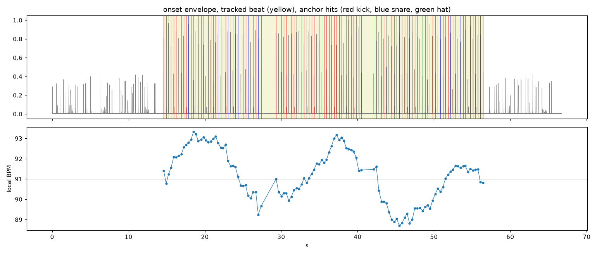

# Ableton Warp Grid (Claude skill)

A [Claude Code](https://claude.com/claude-code) skill that puts a played,
sampled or ripped recording on the grid in the Ableton Live 12 set you have
open, on macOS.

Ask Claude "get the drum stem on the grid, not sure the BPM is right" and it will:

- find the **real BPM** and **how the groove counts**: snare on 2 and 4 means
  91 not 182, 174 not 87; snare on 3 means half-time 140, not 70. It tells you
  the other way to count it if that's a fair call too,
- find the **first downbeat**, and leave talking or free-time intros and outros
  out of the beat,
- measure the **flux**: how far the player drifts (e.g. 88.7 to 93.3 BPM) and
  their feel (e.g. "the and of 4 is 29 ms late every bar"),
- put a **warp marker on every hit**, each moved to its exact grid spot, so
  the drift is warped out. Or only on the beats (keeps the swing), or only on
  the downbeats (removes the drift, keeps the groove),
- put **the same warp map on every stem** of the take (drums, vocals, bass,
  from Kits.ai, Demucs, LALAL, RX, Moises…) so they stay sample-locked to each
  other: drums in Beats mode, the rest in Complex Pro, all on Follow,
- reopen clips Live **cut short** when it auto-warped them, and keep any
  pieces you've already split or moved,
- **save your set first**, keep a backup, reload the set in Live and check that
  Live kept every marker.

Made by [Vivid Fever Dreams](https://github.com/vividfeverdreams) for
flipping live recordings, and shared so other producers can bend it to their
own workflow. Companion to
[ableton-stem-export](https://github.com/vividfeverdreams/ableton-stem-export).

## How it works

Live's auto-warp guesses one tempo for the whole file, often double or half,
and doesn't follow a player who speeds up and slows down. This skill does the
analysis itself and hands Live a finished warp map:

1. **Hits.** Detects every transient and pins it to its attack start, so
   markers sit on the front of the kick, not its middle. Buzz inside a
   beatboxed kick, flams and room hits count as one note.
2. **Pulse and beat.** Finds the pulse (an autocorrelation that a syncopated
   groove can't fool), follows it through the file with a dynamic-programming
   beat tracker, and keeps only the stretch where hits sit on a grid.
3. **Counting and downbeat.** Scores every way to count it from where the low
   end (kick) and the 1-5 kHz band (snare, clap) land in the bar.
4. **Warp map.** Builds one marker per grid note (8th by default), fills
   gaps with weaker hits, and extends the intro and outro at the edge tempo so
   they play at almost their recorded speed.
5. **Into the set.** Writes the map into your `.als` as text (every other byte
   stays the same), Live reloads it, and the skill reads it back to confirm.

Here's the analysis of one of the test takes: a boom-bap loop drifting
between 89 and 93 BPM, with talking before and after it.



```
ways to count it:
  -> 90.97 BPM  backbeat  score 1.15  (backbeat evidence 1.12, half-time evidence 0.06)
     181.94 BPM  half-time score 0.99  (backbeat evidence -0.16, half-time evidence 1.01)
chosen: 90.97 BPM average (backbeat pattern inside 80-180 BPM); first downbeat at 14.612s
local tempo 88.7-93.3 BPM; hits vs one steady tempo: median 42.0 ms, max 109.1 ms
feel (avg ms vs local tempo, + = late): 1 -2, 1& +1, 2 -16, 2& -2, 3 -1, 3& -5, 4 -6, 4& +29

121 warp markers (8th grid): 119 on tracked hits, 0 on weak hits, 2 at the file edges
set tempo 91 (average 90.97); first downbeat 14.612s -> clip bar 7

119 grid notes (8th) at 91 BPM
  before, 91 BPM from beat 1: median 101.2 ms, p90 156.8, max 162.9 (3% within 15 ms)
  after warp                 : median 0.0 ms, p90 0.0, max 0.0 (100% within 15 ms)
```

## Requirements

- macOS and **Ableton Live 12**.
- Claude Code (CLI or desktop app) or another agent that can load skills.
- Accessibility permission for the app that runs Claude
  (System Settings → Privacy & Security → Accessibility), to save and reload
  the set through Live's menus.
- Python 3 with `numpy`, `scipy`, `soundfile` (and `matplotlib` for the plot).
  The skill makes this venv itself the first time; to do it by hand:
  `python3 -m venv ~/.venvs/warp && ~/.venvs/warp/bin/pip install -r requirements.txt`

## Install

```bash
git clone https://github.com/vividfeverdreams/ableton-warp-grid.git
mkdir -p ~/.claude/skills
cp -R ableton-warp-grid ~/.claude/skills/ableton-warp-grid
```

Then, with your set open in Live, ask Claude something like:

> the drum stem in my open set was played live, grid it up and make the other stems follow it

> what BPM is this sample really, and can you warp it to the grid

> Live thinks this break is 172 but it's half that, fix the warp

## Options worth knowing

| You want | Ask for / flag |
| --- | --- |
| Every hit locked to the grid (default) | `--snap 8th`, or `16th` for busy hats |
| Drift gone, swing inside each beat kept | `--snap beat` (also for triplet/shuffle grooves) |
| Only the drift gone, whole groove kept | `--snap bar` |
| A different way to count it (75 boom-bap, not 150) | `--bpm-near 75` |
| Only part of the file (one section) | `--start` / `--end` in seconds |
| The set tempo to breathe with the player | `--leader` (Live's Tempo Leader switch) |

On "make it the leader": the skill makes the drums the reference everything
follows by putting their map on every stem. Live's own Tempo **Leader** switch
is something else: with a tight map it swings the set tempo around every early
or late note. So the default is Follow, and the skill explains the difference.

## Scripts

| Script | What it does |
| --- | --- |
| `scripts/inspect_clips.py` | Lists a set's audio clips: warp state, markers, Leader/Follow, stems of one take, clips cut short (read-only) |
| `scripts/analyze_take.py` | Finds the hits, tempo, counting, downbeat, beat region, flux and feel; `--plot` draws it |
| `scripts/build_warp_map.py` | Turns the analysis into a warp map at the snap level you choose |
| `scripts/qc_grid.py` | How far the notes sit off the grid before and after, and where markers sit on the attack |
| `scripts/patch_warp.py` | Writes the map into a copy of the `.als` for every matching clip, plus warp modes and tempo |
| `scripts/audio_hits.py`, `scripts/als_tools.py` | Shared helpers |

[`references/als-format.md`](references/als-format.md) documents the warp,
loop and tempo XML in a Live 12 set, including how split clips are stored.

## Tests

```bash
~/.venvs/warp/bin/python tests/run_tests.py /tmp/warp-tests --seeds 8
```

It makes synthetic drum takes with known answers and checks the tempo, the
counting, the downbeat, the beat region and that every note lands on its
exact beat after warping: boom-bap 91 with talking and a late "and" of 4,
DnB 174 with 16th hats, half-time 140, house 126, and a drummer rushing from
96 to 104.5 BPM. 40 of 40 pass (most notes within 1 ms of the grid).
It was also checked on a real beatboxed drum stem against a map built by hand.

## Limitations

- macOS + Live 12 only. The `.als` format is documented for Live 12.4; check
  `references/als-format.md` against a new Live version before trusting it.
- Arrangement clips only, not Session View clips. Sets with tempo automation
  are left alone.
- One tempo section per map. A take that changes tempo (a breakdown at a new
  BPM) needs each section analysed with `--start/--end` and the maps joined.
- Stems must come from one export of the take (identical length in samples);
  a consolidated or bounced copy is skipped, and listed.
- The agent can't listen. Check it by ear with the metronome on.

## License

MIT. See [LICENSE](LICENSE).
